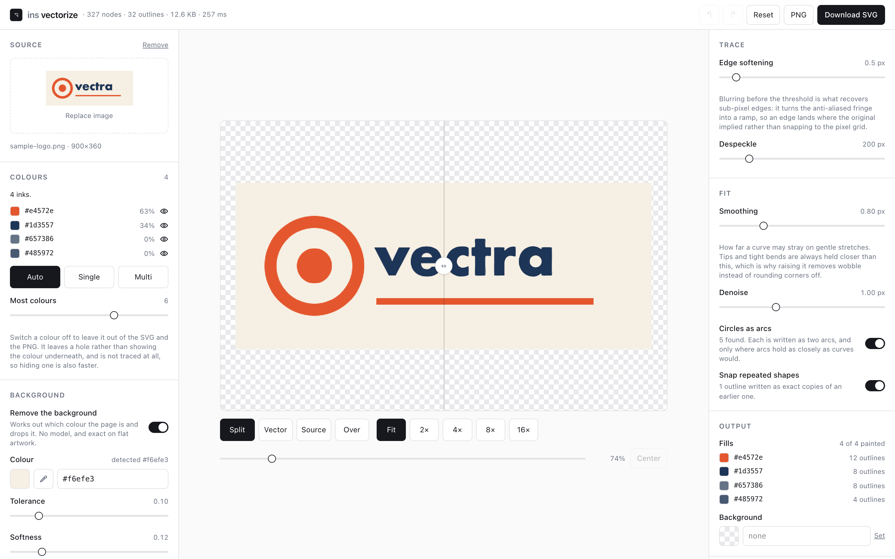

# ins-vectorize

Drop a PNG or JPG in, get a clean SVG out. Runs entirely in the browser.



```bash
cd web && npm install && npm run dev     # http://localhost:5173
```

## Why this exists

potrace is free, excellent, and thirty years old, so tracing a bitmap is a solved
problem and not the interesting part. What separates a usable vector from a traced
one is everything that happens *after* the trace, and that is where Illustrator's
Image Trace and the online converters all leave you: four hundred nodes where twelve
would do, the bitmap's staircase baked into every edge, circles spelled out as two
hundred cubics.

The fitter here comes from `logo_svg.py`, an unpublished script written to build one
client's logo set, which turned out to be general. Comments that cite `logo_svg.py:NNN`
point into that script; the measurements below were taken on that logo set — a
wordmark, a badge and an emblem — referred to as the reference artwork.
Its idea: derive the fitting tolerance from the **local radius of curvature**. Gentle
stretches get a loose tolerance, because the only thing to follow there is the
bitmap's own noise. Tips and tight bends get 0.2 px, because that is where the detail
is real. Then Schneider's least-squares fit finds the fewest curves that stay inside
it.

## How a trace runs

| stage | module | what it does |
|---|---|---|
| ink | `trace/ink.ts` | how much of each pixel is artwork rather than background |
| prepare | `trace/prepare.ts`, `trace/crop.ts` | pad, blur, enlarge 4×, threshold — around each layer's own ink |
| trace | `trace/potrace.ts` | potrace, compiled to WebAssembly |
| resample | `trace/resample.ts` | even samples, and how sharply the outline bends at each |
| fit | `trace/fit.ts` | ★ curvature-adaptive tolerance, Schneider + Newton |
| circles | `trace/shapes.ts` | an outline that is a circle, as two arcs |
| repeats | `trace/repeats.ts` | a shape that repeats, as exact copies of its first appearance |
| emit | `trace/emit.ts` | path data and the document |

`trace/tracer.ts` runs those in order and remembers each stage's last answers; it runs in a
worker (`trace/worker.ts`), so none of it touches the page's thread.

The odd-looking step is prepare: blurring *before* enlarging looks like throwing
detail away. It is the opposite. A hard edge in the source sits between two pixels
and only the anti-aliasing says where; blur turns that fringe into a ramp, the
upscale gives the ramp room, and thresholding puts the edge back at the sub-pixel
position the original implied. Threshold first and every edge snaps to the pixel
grid — which is exactly the staircase every mediocre tracer reproduces.

## Background removal

There is no neural net, and for flat artwork there should not be. `trace/ink.ts`
finds the background colour from the image border and measures every pixel's
distance from it in Oklab, which tracks what the eye calls "a different colour"
where plain RGB does not. On a logo this is *exact* rather than predicted, and it
finishes before a model would have loaded. It is also the first step of every trace,
because "what is the background" and "what should be traced" are the same question.

`@imgly/background-removal` is the fallback if photographic cutout is ever wanted —
lazily imported so its models never load unless asked for.

## Colour

The same mask answers the opposite question. Once it says which pixels are *not*
background, `trace/census.ts` buckets them, merges buckets within 0.02 Oklab, and ranks
what is left. The top entry is the ink, so a red logo traces to red rather than to a
hardcoded black. Rim pixels get no vote — a disc's edge runs through every shade
between the ink and the page, and letting those vote drags the answer towards white.

Deciding whether the *rest* of the ranking is more inks or just noise took three tries,
and the two failures are worth recording because each looks fine until it doesn't:

- **Share cannot do it.** A real second ink covering 3% and a blur smear of *one* ink
  both produce a 3% second cluster.
- **Geometry alone cannot do it.** A smear lies *on* the line between its ink and the
  page, so distance from that line separates smears from off-axis inks — but a logo in
  black and **mid-grey on white** puts a genuine ink exactly on that line too.

What works is both, OR'd with a spatial signal: an ink is real when it is far enough
from the dominant ink **and** either sits off the ink-to-background axis **or** is solid
rather than a thin band hugging an edge (measured: real inks 98% interior, smears
0–1%). Every constant in `census.ts` carries the measurement that chose it.

## Multi-colour

Each ink gets its own coverage map, and **every layer carries the ones painted above
it**, so the upper layers cover the joins. Two consequences worth knowing:

- `layers[0]` comes out byte-identical to the single-colour mask, so multi-colour is
  "the same trace, plus accents on top" and can never lose the silhouette.
- Seams are closed structurally, not statistically: at a junction the lower layer has no
  boundary at all, so blurring and thresholding each layer separately has nothing to
  displace. Simulated on a 753 px boundary, disjoint masks tear open 220 px of gaps in
  7 px runs; this leaves 4 isolated pixels.

`polygon-clipping` is **not** used and is not a dependency. Its ESM build exports only a
default while its types declare named exports, so `import { union }` typechecks and then
fails at runtime — and none of this needs polygon booleans anyway, because the stacking
is done on raster coverage before tracing.

A pixel is shared between two inks only when its own ink cannot account for it.
Measured on red and blue over white: rim pixels sit 0.008–0.016 from their own ink's
blend line at every coverage, boundary pixels 0.031–0.271 at every mix. That gap is the
gate. The distance *between* the two nearest inks is not — both populations span roughly
0.02 to 0.25 there, so no threshold on it can work.

How many inks get painted is **capped rather than counted**. `palette.limit` is a maximum,
not a number of layers: how many inks an image has is a fact about the image, while the spec
describes the job — and a count would persist, so a six chosen for one picture would follow
the user onto a two-colour one. Its ceiling is `census.ts`'s own `MAX_INKS`, so the control
can always reach every ink the census is able to report. A test holds those two numbers
together, because drifting apart would leave a palette row that no setting can paint and
nothing on screen to say why.

## Switching a colour off

Each ink in the palette has a switch, and the export carries what is switched on — both
exports, since `cutout.ts` and the tracer take their answer from the same `separate.ts`.
It is stored as `palette.hidden`, a list of **hexes rather than indices**: the palette's
order moves with `background.tolerance`, so an index would come to mean a different
colour the moment that slider moved.

Two things about it are deliberate and neither is obvious:

- **A hidden ink stays in the palette and is switched off there.** Filtering it out of
  the list instead would hand its pixels to whichever surviving ink sits nearest, so
  hiding an accent would repaint it in the colour underneath. What hiding a layer means
  is a **hole**, and the hole is why `splitLayers` takes a visibility mask rather than a
  shorter list of inks: a hidden ink is withheld from the accumulator, so the layers
  below never carry its pixels. `selftest.ts` states this as geometry — switch off the
  blue accent in the three-ink fixture and the silhouette has to stop at the black's
  edge, not keep reaching the blue's.
- **A hidden layer is never traced.** `prepare` holds a bitmap 16× the canvas and potrace
  scans all of it however few pixels are set, so skipping is what makes switching a
  colour off cheaper rather than merely quieter. Measured on the three-ink fixture: 36 ms
  at three colours, 22 ms with the accent off.

One combination is worth knowing about, because it is not obvious and it is the reason
this exists. Turn **background removal off** and the mask becomes the image's own alpha,
so the page counts as an ink: it lands at the bottom of the stack with the artwork
layered over it, and gets a switch like everything else. On artwork whose colours sit
close to the page — where a tolerance either eats the artwork or leaves a halo — that can
beat removing the background at all, and switching the page's own colour off afterwards
is what gets the transparency back.

The cut-out's alpha is the coverage of the **lowest visible layer**, which needs no
second pass: every layer already carries the ones above it, so the bottom-most one still
showing *is* the sum of all of them. With nothing hidden that is the ink mask itself,
which is why a PNG does not shift by a count in the last place just because the palette
was split on the way past.

## Off the main thread

The trace runs in a module worker. `trace/host.ts` is a queue one deep: a newer request
replaces whatever was waiting, and a running trace looks between stages for one, abandoning
itself if there is — potrace cannot be interrupted mid-call, so a stage boundary is the
soonest it can give way. The image crosses to the worker once per source rather than once
per trace, and a result leaves the census's per-pixel working behind: one Int32 per pixel,
read by nothing on the page.

Each stage reads part of the spec and is remembered under that part, serialised whole —
`background` and `palette` for the separation, `trace` and the layer's own mask for
potrace, `fit` for the refit — so a Fit slider never reaches potrace and an Output change
is a string join. Keys are whole sections rather than chosen fields, and `tracer.test.ts`
changes every field in turn to hold each one to the stage that reads it.

Measured on the 2046 px reference wordmark in Chrome, dragging Smoothing: the longest gap
between frames went from **717 ms to 17 ms**, and the trace that lands when the drag stops
from 742 ms to 43 ms. A second change of smoothing costs 59 ms instead of 821; a page
colour, nothing measurable.

## Cropping

`prepare` is where a layer's time goes — 461 of 790 ms on the wordmark — and it used to
enlarge the whole canvas for every layer, however little of it the layer's ink covers. Now
each layer is prepared from a box around its own ink, and the output is **byte-identical**:
checked on every image here, and by a selftest that traces every fixture's layers both ways.

Two findings made that true, and both were found by the check failing first:

- **potrace is not translation-invariant.** Its arithmetic runs on absolute bitmap
  coordinates. Handing it identical pixels with 32 px or less to their left traced the
  ring fixture's hole differently from the full canvas; 40 px, the same; 256 px of extra
  border all round, different again. Only the left edge mattered. So the prepared crop is
  put back in place, in a bitmap that keeps the canvas's left and bottom edges — potrace
  measures y from the bottom — and only the empty space to the right and above is dropped.
- **A soft colour split scatters faint coverage across a layer.** With a small blue accent
  added to the wordmark, the accent's layer held 3,467 pixels of coverage 1–29 spread over
  the whole word, and a box around "any coverage" was a box around everything. Coverage
  below 127 / `upscaleGain` cannot set a pixel on its own — blur averages, and the Lanczos
  overshoot is bounded — so the box leaves it out, and the margin is doubled so that no
  pixel near the crop's edge can tell whether it was cropped.

On that two-colour image the trace went from **2090 ms to 1170 ms**. The wordmark alone
barely moves (844 → 821 ms): its one layer's ink spans the frame, so there is nothing to
crop, and the blur and the enlargement are still the cost.

## Circles

An outline that is a circle comes out as two arcs. It is accepted only inside the
allowance the cubics would have been held to: every sample within `tolerance(turning)` of
the circle, and within what a true circle of that radius would be allowed — so an ellipse
3 px out of round, a rounded rectangle or a lopsided blob stays curves, and arcs are never
less faithful than the curves they replace. The winding is kept, because nonzero fill only
cuts a ring's hole because it runs the other way.

The arc's endpoints are written from a centre and radius already rounded to the output's
two decimals. Rounded separately they can land a hundredth short of a diameter, and each
half-arc then bows out by about √(r·0.01) — a whole pixel on a 100 px circle.

## Repeated shapes

potrace's sensitivity to position has a visible consequence: the wordmark's two t's and
two a's trace a few hundredths and a node or two apart. Shapes that are the same shape
moved are now written as exact copies of their first appearance, number for number apart
from the shift. It generalises `logo_svg.py:354`, which recognised letters as contours
taller than 200 px, holes by bounding box, and a match by box and area — none of which
travels, and the last of which cannot tell a b from a d. Here holes are found by winding
and containment, and a match is confirmed on the outlines themselves.

How close counts as the same is a share of the shape's scale, √area, and each half of that
was measured:

- **A share, not a distance.** The t's and a's trace 0.59 and 0.63 px apart in the 568 px
  export, 2.31 and 1.47 px in the 2046 px one.
- **Of √area, not of length.** Against their longest side the glyphs agree to 0.3–0.5% —
  but so do the reference badge's two 724 × 2.5 px rules, whose ends differ by 3.8 px. Against
  √area the glyphs are 0.43–0.84%, the rules 11%, a textured badge's hairlines 5–25%.

1.5% is nearly twice the worst glyph. Both wordmark exports now snap the same three
outlines, and the badge's rules are left alone. Below 30 px or so the floor takes over —
the fitter's own 0.2 px plus half a sample — so specks snap only to specks that are the
same to the tracer's resolution.

## Parity

`web/src/trace/fit.ts` is a port, and a port is worth what its evidence is worth.

```bash
LOGO_SVG=/path/to/logo_svg.py python parity/dump.py         # ground truth
cd web && npm test                                            # hold the port to it
```

`logo_svg.py` is not published, so only its author can regenerate `parity/expected.json`;
the committed copy is what the tests hold the port to, and everyone can run those.
`parity/dump.py` drives the original Python over the contours in
`parity/fixtures/contours.json` and records what it produced. The test suite runs the
TypeScript over the same contours and requires agreement within 0.01 px. When they
disagree, the port is wrong — the Python is the one with logos shipped from it.

Image preprocessing is deliberately outside the parity check: Pillow and this code
necessarily resample differently, and pretending otherwise would make the check
either meaningless or permanently red. What is checked is what was ported.

## End to end

```bash
cd web && npm run verify     # headless
```

`npm test` covers the maths, which is pure. It cannot cover potrace, or the mapping
from potrace's coordinates back into source pixels — and that mapping is exactly
where a silent error looks plausible. A y-flip, a forgotten division by the upscale
factor, a missing `PAD` offset: each leaves curves that are individually fine and
collectively in the wrong place. So `verify` traces shapes whose geometry is known
exactly — a disc, a ring, an off-centre rectangle, a red disc on white — and checks
the bounding boxes against the numbers they must produce. It also traces every layer
cropped and whole and requires no drift at all, runs a remembering tracer against a
forgetful one through a sequence of settings, and checks circles and repeated shapes on
fixtures built to tempt them: a dot, a ring's hole, a b beside a b and a b beside a d.
The same assertions run in a browser at `/verify.html`, which also shows each result
beside its source, and checks that the worker starts and answers exactly as the page
would.

For the record, potrace emits `translate(0,H) scale(0.1,-0.1)`: tenths of a pixel,
with the y-flip carried in the transform's negative scale.

Running this outside a browser needs two stand-ins, both confined to
`web/scripts/selftest.ts`. `esm-potrace-wasm` declares `"type": "module"` but its
node branch calls bare `require`, so it cannot load under node ESM as published;
and node has no `ImageData`. Neither stand-in touches the code being tested.

## Not done yet

- **Arcs inside an outline.** Only outlines that are whole circles become arcs. A rounded
  corner is still cubics: that needs each outline split at its corners and every run
  offered a line, an arc or curves.
- **`prepare` is still the cost.** Cropping only helps a layer whose ink leaves some of the
  frame empty; a wordmark that spans it traces as slowly as before, and the blur and the
  Lanczos enlargement are most of that. They are plain JavaScript loops over a 16× canvas.
- **Textured artwork pays for circles and repeats.** Finding holes compares every outline
  with every other by point-in-polygon, and on a badge with 900 outlines of texture the
  fit stage takes 845 ms instead of 610 — a quarter of a second a wordmark never notices.
- **The canvas keeps the source's full frame**, dead margin and all, where `logo_svg.py`
  trims to the artwork first.
- **Fine artwork still loses to a rebuild.** Traced at the default, the reference emblem
  keeps its hairlines; the shipped logo's are still cleaner, because that
  glyph is not traced at all but reconstructed from measured geometry
  (`logo_svg.py:401-454`). No tracer wins that comparison — it is worth knowing where
  the ceiling is.

## Licence

**GPL-2.0** — the full text is in [LICENSE](LICENSE). Copyright (C) 2026 Ying-Shiuan Chen.

This licence is driven by the tracing dependency: potrace is GPL-2.0 and
`esm-potrace-wasm` carries that licence forward. ins-vectorize bundles that tracer, so
it is distributed under GPL-2.0 too. `LICENSE` is byte-for-byte the copy that dependency
ships, which is the canonical FSF text.

That is fine for a local tool or an open-source project. It does mean this cannot be
distributed as a closed-source proprietary application under the current tracer.

If a permissive licence is ever needed, the tracing dependency is the part that has to
be replaced — or licensed separately from its author. The rest of ins-vectorize, the
fitter included, is this project's own code and does not otherwise require GPL-2.0.
